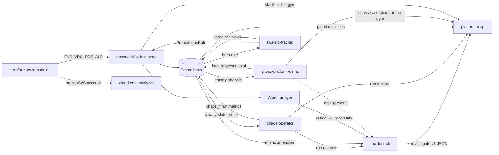

# SRE platform

Eight repositories that were built separately and describe one system: provision
a cluster, install the observability stack, ship a service through it, prove the
service survives failure, notice when it stops, and triage what changed. The
last one breaks the others on purpose and checks how often an AI investigator
gets the triage right.

This page is the map. Each repo stands alone and is linked below, but the
interesting part is where they meet, so this page is mostly about the seams.

## The loop

Solid edges are wired and checked in CI somewhere. Dashed edges are places the
two sides already speak the same language but nothing connects them yet, listed
in full further down.

## The repos

| Repo | What it is | The thing worth opening |
|------|------------|-------------------------|
| [terraform-aws-modules](https://github.com/jamespham8929/terraform-aws-modules) | VPC, EKS, RDS, and ALB modules with terratest coverage | `examples/complete`, which wires all four together |
| [observability-bootstrap](https://github.com/jamespham8929/observability-bootstrap) | The stack, plus SLO burn-rate alerting generated from objectives | `tests/slo_burn_rate_test.yaml`, where the alerts are unit-tested against synthetic series |
| [gitops-platform-demo](https://github.com/jamespham8929/gitops-platform-demo) | ArgoCD delivery with an Argo Rollouts canary that cancels itself | `docs/canary-rollback.md`, reproducible on kind |
| [k8s-slo-tracker](https://github.com/jamespham8929/k8s-slo-tracker) | Burn-rate alerting that refuses to page on statistically meaningless traffic | `slo_tracker/confidence.py` and the false-page benchmark |
| [chaos-operator](https://github.com/jamespham8929/chaos-operator) | A chaos operator built safety-first: steady-state verification and blast-radius guards | [ADR 0001](https://github.com/jamespham8929/chaos-operator/blob/main/docs/adr/0001-steady-state-as-a-statistical-claim.md), steady state as a statistical claim |
| [incident-cli](https://github.com/jamespham8929/incident-cli) | Reconstructs an incident timeline and ranks what probably caused it | `internal/timeline/correlator.go` and the ranking benchmark |
| [cloud-cost-analyzer](https://github.com/jamespham8929/cloud-cost-analyzer) | Rightsizing that sizes from the recurring peak instead of an average or a p95 | `cloud_cost_analyzer/temporal_rightsizing.py` |
| [platform-mcp](https://github.com/jamespham8929/platform-mcp) | Read-only MCP tools over the platform, and an incident gym that grades AI investigators on real faults | [ADR 0003](https://github.com/jamespham8929/platform-mcp/blob/main/docs/adr/0003-incident-gym.md), recording incidents on kind and replaying them in CI |

## Where the seams line up

**One metric, three readers.** `http_requests_total{service, code}` is emitted by
the sample service in gitops-platform-demo, and read by three different things
for three different purposes:

- The canary AnalysisTemplate, to decide whether a rollout finishes or aborts.
- The SLO recording rules in observability-bootstrap, which turn it into
  `slo:sli_error:ratio_rate5m` and friends.
- The steady-state hypothesis in chaos-operator, to decide whether an experiment
  is safe to start and whether the system recovered afterwards.

The label is `code` rather than `status` in all four repos, which is the
promhttp convention. observability-bootstrap enforces it: a dashboard that
queries a label nothing produces fails CI, which is how the last disagreement
between these repos got found.

**One record name, two producers.** `slo-tracker generate-alerts | kubectl apply
-f -` installs into the stack observability-bootstrap builds. Both emit
`slo:sli_error:ratio_rate{window}` under the same labels, both name their alerts
`SLOErrorBudgetBurnCritical` and `SLOErrorBudgetBurnWarning`, and three of their
four burn-rate tiers are identical (14.4x over 1h/5m, 6x over 6h/30m, 1x over
3d/6h). The generated manifest carries the `release` label the operator selects
on and the `team` label Alertmanager routes on, so the same routing, inhibition,
and runbooks apply whichever side the rules came from.

What does not carry across is the confidence gating. PromQL cannot express a
Wilson lower bound, so exported rules behave like the textbook method. The
tracker closes that gap with `slo-tracker serve`, a daemon that runs the gated
engine every minute and exports each decision as a metric.
`generate-alerts --engine gated` then writes alerts that read the decision,
under the same names and labels, so the routing above does not change.

**One Prometheus, read and written by everyone.** chaos-operator now exports
its runs, aborts, and missed schedule slots, so an experiment shows up in the
stack it is testing. incident-cli reads Prometheus too. A sustained shift in a
saturation or dependency metric becomes a candidate cause on the timeline.

**One run ID.** Each chaos-operator run leaves a record in the experiment's
status, with an ID like `payments/nightly/20261124T030005Z`. incident-cli reads
those records as candidate causes, under the same ID. So a page during a game
day names the experiment, and the run can be looked up from the timeline.

**One contract for agents.** incident-cli can print its ranking as versioned
JSON (`incident-cli/investigate/v1`). platform-mcp runs the real binary and
serves that result to agents as an MCP tool, next to the chaos run records and
the SLO decisions. Every item has an evidence ID, so each claim in an agent's
answer can be checked. CI builds incident-cli from main and runs the baseline
through MCP. It fails if any planted cause ranks differently from the
benchmark.

**One gym.** platform-mcp's incident gym runs five of these repos together on
kind. observability-bootstrap's stack watches a shop built from
gitops-platform-demo's service and chart. chaos-operator breaks it, a
Prometheus rule pages, and incident-cli ranks the causes through MCP. The gym
records the raw samples, and CI replays them without a cluster. Getting there
found two real bugs. chaos-operator recorded faults that never ran, and its
deployment could not start at all. In the first recordings, incident-cli
ranked the page's own symptoms above the cause in all five scenarios. It now
traces how a failure spreads through the dependency graph, and names all five
causes first. Those five shaped the fix, so the next scenarios are the real
test.

**One Prometheus address.** chaos-operator's experiments point at
`prometheus-operated.monitoring:9090` and the gitops canary analysis points at
`kube-prometheus-stack-prometheus.monitoring.svc:9090`. Both are services that
observability-bootstrap's install actually creates.

**One alert path.** Alertmanager routes critical alerts to PagerDuty, and
incident-cli's PagerDutySource turns recent PagerDuty incidents back into
candidate events on the timeline. An alert that fires in the first repo shows up
in the last one.

**One account.** cloud-cost-analyzer reads CloudWatch for the same instances
terraform-aws-modules provisions.

## Where they don't line up, yet

Being explicit about this is the point of the page. Three things are still loose:

1. **The two sides still define the error ratio differently.** k8s-slo-tracker
   counts anything that is not a 2xx, observability-bootstrap counts 5xx, so a
   burst of 404s burns budget under one and not the other. The tracker takes its
   definition from each SLO's configured queries now, so settling this is a
   config change rather than a code change, but nothing settles it today.
2. **The delivery pipeline emits no deploy events.** incident-cli reads the
   GitHub Deployments API, and gitops-platform-demo's promotion workflow opens a
   PR and lets ArgoCD sync without recording a deployment. One API call in the
   promotion job closes this, and it is the highest-value connection left.
3. **The loop runs end to end, but not all of it.** platform-mcp's gym
   installs the stack, ships the service, breaks it, pages, and triages the
   result. It does not deliver through ArgoCD, and k8s-slo-tracker's daemon is
   not in it yet, so the SLO side of the loop is still only asserted.

## Reading this in ten minutes

If you only open a few files, these are the ones where the reasoning is visible:

1. [The canary that cancels itself](https://github.com/jamespham8929/gitops-platform-demo/blob/main/docs/canary-rollback.md).
   A build that passes every probe and still needs to be stopped, and the
   analysis run that stops it.
2. [Why burn-rate alerts pair two windows](https://github.com/jamespham8929/observability-bootstrap/blob/main/docs/adr/0002-multi-window-burn-rate-alerts.md),
   and what a total outage does to a ratio-based alert.
3. [Confidence-gated burn rate](https://github.com/jamespham8929/k8s-slo-tracker/blob/main/docs/adr/0002-confidence-gated-burn-rate.md).
   What to do when six requests a minute make the observed error ratio
   meaningless.
4. [Scoring a dependency graph](https://github.com/jamespham8929/incident-cli/blob/main/docs/adr/0002-dependency-graph-relevance.md),
   including the benchmark showing it is a trade rather than a free win.
5. [Sizing from the recurring peak](https://github.com/jamespham8929/cloud-cost-analyzer/blob/main/docs/adr/0001-size-from-recurring-peak.md),
   and why an overall p95 waves through a downsize that the daily spike will not
   fit into.
6. [Grading incident investigators](https://github.com/jamespham8929/platform-mcp/blob/main/docs/adr/0002-grading-investigators.md).
   How an AI agent is scored on incidents with a known cause, and why the
   synthetic set favors the baseline.
