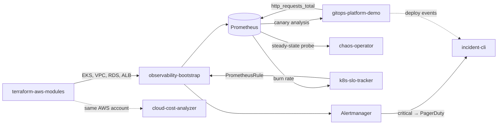

# SRE platform

Seven repositories that were built separately and describe one system: provision
a cluster, install the observability stack, ship a service through it, prove the
service survives failure, notice when it stops, and triage what changed.

This page is the map. Each repo stands alone and is linked below, but the
interesting part is where they meet, so this page is mostly about the seams.

## The loop

Solid edges are wired and checked in CI somewhere. Dashed edges are places the
two sides already speak the same language but nothing connects them yet, listed
in full further down.

## The repos

| Repo | What it is | The thing worth opening |
|------|------------|-------------------------|
| [terraform-aws-modules](https://github.com/jamespham8929/terraform-aws-modules) | VPC, EKS, RDS, and ALB modules with terratest coverage | `examples/complete`, which wires all four together |
| [observability-bootstrap](https://github.com/jamespham8929/observability-bootstrap) | The stack, plus SLO burn-rate alerting generated from objectives | `tests/slo_burn_rate_test.yaml`, where the alerts are unit-tested against synthetic series |
| [gitops-platform-demo](https://github.com/jamespham8929/gitops-platform-demo) | ArgoCD delivery with an Argo Rollouts canary that cancels itself | `docs/canary-rollback.md`, reproducible on kind |
| [k8s-slo-tracker](https://github.com/jamespham8929/k8s-slo-tracker) | Burn-rate alerting that refuses to page on statistically meaningless traffic | `slo_tracker/confidence.py` and the false-page benchmark |
| [chaos-operator](https://github.com/jamespham8929/chaos-operator) | A chaos operator built safety-first: steady-state verification and blast-radius guards | [ADR 0001](https://github.com/jamespham8929/chaos-operator/blob/main/docs/adr/0001-steady-state-as-a-statistical-claim.md), steady state as a statistical claim |
| [incident-cli](https://github.com/jamespham8929/incident-cli) | Reconstructs an incident timeline and ranks what probably caused it | `internal/timeline/correlator.go` and the ranking benchmark |
| [cloud-cost-analyzer](https://github.com/jamespham8929/cloud-cost-analyzer) | Rightsizing that sizes from the recurring peak instead of an average or a p95 | `cloud_cost_analyzer/temporal_rightsizing.py` |

## Where the seams line up

**One metric, three readers.** `http_requests_total{service, code}` is emitted by
the sample service in gitops-platform-demo, and read by three different things
for three different purposes:

- The canary AnalysisTemplate, to decide whether a rollout finishes or aborts.
- The SLO recording rules in observability-bootstrap, which turn it into
  `slo:sli_error:ratio_rate5m` and friends.
- The steady-state hypothesis in chaos-operator, to decide whether an experiment
  is safe to start and whether the system recovered afterwards.

The label is `code` rather than `status` in all four repos, which is the
promhttp convention. observability-bootstrap enforces it: a dashboard that
queries a label nothing produces fails CI, which is how the last disagreement
between these repos got found.

**One record name, two producers.** `slo-tracker generate-alerts | kubectl apply
-f -` installs into the stack observability-bootstrap builds. Both emit
`slo:sli_error:ratio_rate{window}` under the same labels, both name their alerts
`SLOErrorBudgetBurnCritical` and `SLOErrorBudgetBurnWarning`, and three of their
four burn-rate tiers are identical (14.4x over 1h/5m, 6x over 6h/30m, 1x over
3d/6h). The generated manifest carries the `release` label the operator selects
on and the `team` label Alertmanager routes on, so the same routing, inhibition,
and runbooks apply whichever side the rules came from.

What does not carry across is the confidence gating. PromQL cannot express a
Wilson lower bound, so exported rules behave like the textbook method, and the
low-traffic judgement stays in the tracker's own evaluate path.

**One Prometheus address.** chaos-operator's experiments point at
`prometheus-operated.monitoring:9090` and the gitops canary analysis points at
`kube-prometheus-stack-prometheus.monitoring.svc:9090`. Both are services that
observability-bootstrap's install actually creates.

**One alert path.** Alertmanager routes critical alerts to PagerDuty, and
incident-cli's PagerDutySource turns recent PagerDuty incidents back into
candidate events on the timeline. An alert that fires in the first repo shows up
in the last one.

**One account.** cloud-cost-analyzer reads CloudWatch for the same instances
terraform-aws-modules provisions.

## Where they don't line up, yet

Being explicit about this is the point of the page. Four things are still loose:

1. **The two sides still define the error ratio differently.** k8s-slo-tracker
   counts anything that is not a 2xx, observability-bootstrap counts 5xx, so a
   burst of 404s burns budget under one and not the other. The tracker takes its
   definition from each SLO's configured queries now, so settling this is a
   config change rather than a code change, but nothing settles it today.
2. **The delivery pipeline emits no deploy events.** incident-cli reads the
   GitHub Deployments API, and gitops-platform-demo's promotion workflow opens a
   PR and lets ArgoCD sync without recording a deployment. One API call in the
   promotion job closes this, and it is the highest-value connection left.
3. **chaos-operator exports no metrics of its own.** It reads Prometheus and
   writes nothing back, so an experiment is invisible to the stack it is
   testing.
4. **Nothing runs the loop end to end.** Each repo has its own kind-based demo.
   A `platform-demo` that installs the stack, ships a service, breaks it,
   watches the SLO react, and triages the result with the CLI is the artifact
   that would prove all of the above rather than asserting it.

## Reading this in ten minutes

If you only open a few files, these are the ones where the reasoning is visible:

1. [The canary that cancels itself](https://github.com/jamespham8929/gitops-platform-demo/blob/main/docs/canary-rollback.md).
   A build that passes every probe and still needs to be stopped, and the
   analysis run that stops it.
2. [Why burn-rate alerts pair two windows](https://github.com/jamespham8929/observability-bootstrap/blob/main/docs/adr/0002-multi-window-burn-rate-alerts.md),
   and what a total outage does to a ratio-based alert.
3. [Confidence-gated burn rate](https://github.com/jamespham8929/k8s-slo-tracker/blob/main/docs/adr/0002-confidence-gated-burn-rate.md).
   What to do when six requests a minute make the observed error ratio
   meaningless.
4. [Scoring a dependency graph](https://github.com/jamespham8929/incident-cli/blob/main/docs/adr/0002-dependency-graph-relevance.md),
   including the benchmark showing it is a trade rather than a free win.
5. [Sizing from the recurring peak](https://github.com/jamespham8929/cloud-cost-analyzer/blob/main/docs/adr/0001-size-from-recurring-peak.md),
   and why an overall p95 waves through a downsize that the daily spike will not
   fit into.
